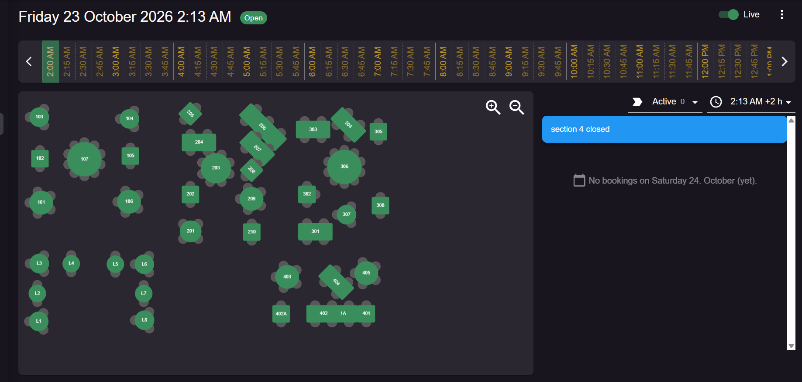

# Floor Plan & Tables Display

Part of [booking](booking.md) (D-006, D-007). The owner provided the room layout on 2026-10-24 (D-032).

*Reference screenshot from the owner: the layout and the UI pattern to follow.*

## Sections (areas)
There are 5 sections, named from the table numbers. A section can be **closed** for a day or service period (the screenshot shows "section 4 closed"; D-033).

| Section | Tables | Count |
|---|---|---|
| Section 1 | 101–107 | 7 |
| Section 2 | 201–210 | 10 |
| Section 3 | 301–308 | 8 |
| Section 4 | 401, 402, 402A, 1A, 403–405 | 7 |
| Section L | L1–L8 | 8 |
| **Total** | | **40** |

## Table list (transcribed from the screenshot)
Positions are in pixels on the reference canvas (≈1180 × 650, origin top-left, table centre). They are for **seed data only**: the owner fine-tunes them in the floor-plan editor. **Seat counts are estimated from the chair icons.** They are used as seed data, and the owner corrects them later in Settings → Areas & tables (D-036).

| Table | Section | Shape | Rotation | x | y | Seats (est.) |
|---|---|---|---|---|---|---|
| 101 | 1 | round | 0° | 52 | 254 | 4 |
| 102 | 1 | square | 0° | 49 | 153 | 2 |
| 103 | 1 | round | 0° | 48 | 58 | 4 |
| 104 | 1 | round | 0° | 255 | 62 | 4 |
| 105 | 1 | square | 0° | 256 | 147 | 2 |
| 106 | 1 | round | 0° | 253 | 252 | 4 |
| 107 | 1 | round, large | 0° | 151 | 155 | 8 |
| 201 | 2 | round | 0° | 394 | 320 | 4 |
| 202 | 2 | square | 0° | 394 | 235 | 2 |
| 203 | 2 | round, large | 0° | 452 | 175 | 6 |
| 204 | 2 | rect | 0° | 413 | 116 | 4 |
| 205 | 2 | square | 45° | 394 | 50 | 2 |
| 206 | 2 | rect, long | 40° | 559 | 80 | 6 |
| 207 | 2 | rect | 40° | 547 | 130 | 4 |
| 208 | 2 | square | 40° | 534 | 180 | 2 |
| 209 | 2 | round | 0° | 534 | 246 | 4 |
| 210 | 2 | square | 0° | 534 | 322 | 2 |
| 301 | 3 | rect | 0° | 680 | 321 | 4 |
| 302 | 3 | square | 0° | 661 | 235 | 2 |
| 303 | 3 | rect | 0° | 675 | 87 | 4 |
| 304 | 3 | rect | 45° | 756 | 76 | 4 |
| 305 | 3 | square | 0° | 825 | 92 | 2 |
| 306 | 3 | round, large | 0° | 747 | 172 | 8 |
| 307 | 3 | round, small | 0° | 751 | 282 | 2 |
| 308 | 3 | square | 0° | 829 | 261 | 2 |
| 401 | 4 | square | 0° | 797 | 510 | 2 |
| 402 | 4 | rect | 0° | 699 | 510 | 4 |
| 1A | 4 | square | 0° | 744 | 510 | 2 |
| 402A | 4 | square | 0° | 602 | 510 | 2 |
| 403 | 4 | round | 0° | 616 | 425 | 4 |
| 404 | 4 | rect | 45° | 728 | 438 | 4 |
| 405 | 4 | round | 0° | 797 | 417 | 4 |
| L1 | L | round, small | 0° | 46 | 528 | 2 |
| L2 | L | round, small | 0° | 43 | 464 | 2 |
| L3 | L | round, small | 0° | 48 | 395 | 2 |
| L4 | L | round, small | 0° | 121 | 395 | 2 |
| L5 | L | round, small | 0° | 222 | 396 | 2 |
| L6 | L | round, small | 0° | 288 | 396 | 2 |
| L7 | L | round, small | 0° | 287 | 464 | 2 |
| L8 | L | round, small | 0° | 289 | 525 | 2 |

**Combinable groups (assumed from the layout):** 402 + 1A + 401 stand in one joined row, so they are seeded as combinable with each other. Every other table is combinable = false until the owner says otherwise.

## Floor plan screen (`/bookings/floor-plan`)
The layout follows the reference screenshot:
- **Header:** full date and time, an **Open/Closed** badge (from opening hours), a **Live** toggle (follows the current time), and an overflow menu.
- **Time strip:** a horizontal, scrollable strip of time slots across opening hours, with arrows to page. The current slot is highlighted. Clicking a slot shows the room at that moment, and the Live toggle switches off.
- **Canvas:** tables drawn at their x/y with shape, size and rotation, and chairs drawn around them. Zoom in/out buttons. Table colour = status (see [ui-components](../architecture/ui-components.md#status-colors-badges)). Closed sections are greyed out.
- **Side panel (right):**
  - a filter dropdown (Active / Seated / Booked / All) with a count
  - a time-window picker ("2:13 AM +2 h": show bookings from the selected time over the next N hours)
  - notices such as "section 4 closed"
  - the booking list for that window, or an empty state ("No bookings on Saturday 24 October (yet).")
- Clicking a table opens its bookings and quick actions: seat walk-in, seat booking, complete.

## Tables display (`/bookings/tables`)
- A grid of table cards grouped by **section**. Each card shows the table, seats, a status badge, and the current or next guest with party size and time ("seated 45 min").
- Statuses: **Free**, **Reserved soon** (booking starts within X min, configurable), **Seated**, **Closed** (section closed).
- The same quick actions and section/status filters as the floor plan.

## Editing (Owner only, Settings → Areas & tables)
Owners can drag to position tables, and set the shape, size, rotation, seats, section and combinable flag. Owners can also open or close a section for a date or service period. Positions are stored on `Table`, closures in `AreaClosure` (see [data-model](../architecture/data-model.md)). Build the canvas from absolutely positioned elements (CSS transforms). Don't add a heavy canvas library unless it's needed.
